# Бормотова Ксения Группа ИКНТ/О ДВБ7-ЛА3-2025 НБ Лабораторная №1

# Задание 1

## Задача 1

### Текст задачи

Сумма знаков.

Дана сигнатура функции: int sumLastNums (int x); Необходимо реализовать функцию таким образом, чтобы она возвращала результат сложения двух последних знаков числах, предполагая, что знаков в числе не менее двух. 
Подсказки:
int x=123%10; // х будет иметь значение 3
int у=123/10; // у будет иметь значение 12
Пример:
x=4568
результат: 14

### Алгоритм решения

1. Получить целое число `x`.
2. Найти последнюю цифру числа с помощью остатка от деления на 10.
3. Найти предпоследнюю цифру числа, разделив число на 10 и снова взяв остаток от деления на 10.
4. Сложить последнюю и предпоследнюю цифры.
5. Вернуть полученную сумму.

### Тестирование

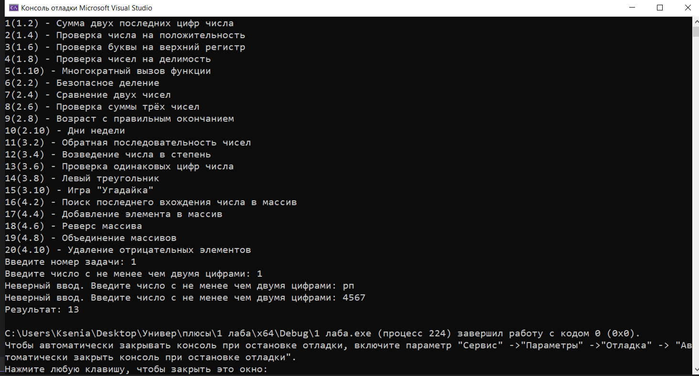

## Задача 2

### Текст задачи

Есть ли позитив.

Дана сигнатура функции: bool isPositive (intx);
Необходимо реализовать функцию таким образом, чтобы она принимала число
x и возвращала true, если оно положительное.
Пример 1:
x=3
результат: true
Пример 2:
x=-5
результат: false

### Алгоритм решения

1. Получить целое число `x`.
2. Сравнить число `x` с нулём.
3. Если `x` больше нуля, вернуть значение `true`.
4. Если `x` не больше нуля, вернуть значение `false`.
5. Вывести полученный результат.

### Тестирование

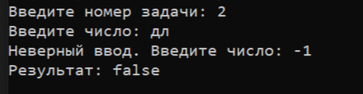

## Задача 3

### Текст задачи

Большая буква.

Дана сигнатура функции: bool isUpperCase (char x);
Необходимо реализовать функцию таким образом, чтобы она принимала
символ x и возвращала true, если это большая буква в диапазоне от ‘A’ до ‘Z’.
Пример 1:
x=’D’
результат: true
Пример 2:
x=’q’
результат: false

### Алгоритм решения

1. Получить один символ `x`.
2. Проверить, находится ли символ в диапазоне от `A` до `Z`.
3. Если символ находится в этом диапазоне, вернуть `true`.
4. Если символ не находится в этом диапазоне, вернуть `false`.
5. Вывести полученный результат.

### Тестирование

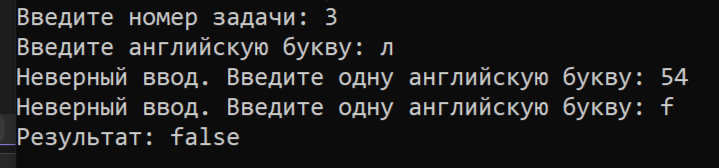

## Задача 4

### Текст задачи

Делитель.

Дана сигнатура функции: bool isDivisor (int a, int b);
Необходимо реализовать функцию таким образом, чтобы она возвращала true,
если любое из принятых чисел делит другое нацело.
Пример 1:
a=3 b=6
результат: true
Пример 2:
a=2 b=15
результат: false

### Алгоритм решения

1. Получить два целых числа `a` и `b`.
2. Проверить, что `a` не равен нулю и `b` делится на `a` без остатка.
3. Если условие выполняется, вернуть `true`.
4. Если первое условие не выполняется, проверить, что `b` не равен нулю и `a` делится на `b` без остатка.
5. Если второе условие выполняется, вернуть `true`.
6. Если ни одно из условий не выполняется, вернуть `false`.
7. Вывести полученный результат.

### Тестирование

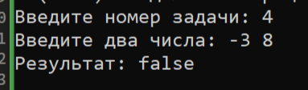
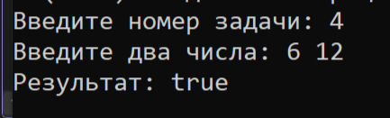

## Задача 5

### Текст задачи

Многократный вызов.

Дана сигнатура функции: int lastNumSum(int a, int b)
Необходимо реализовать функцию таким образом, чтобы она считала сумму
цифр двух чисел из разряда единиц. Выполните с его помощью
последовательное сложение пяти чисел и результат выведите на экран.
Постарайтесь выполнить задачу, используя минимально возможное
количество вспомогательных переменных.
Пример:
5+11 это 6
6+123 это 9
9+14 это 13
13+1 это 4
Итого 4

### Алгоритм решения

1. Ввести первое число и сохранить его в переменную `result`.
2. Проверить корректность ввода. Если введено не число, вывести сообщение об ошибке и повторить ввод.
3. Четыре раза выполнить следующие действия:
   - ввести следующее число в переменную `number`;
   - проверить корректность ввода;
   - вызвать функцию `lastNumSum(result, number)`;
   - сохранить полученный результат в переменную `result`.
4. После завершения цикла вывести значение `result`.
5. Функция `lastNumSum()` складывает последние цифры двух переданных чисел.

### Тестирование

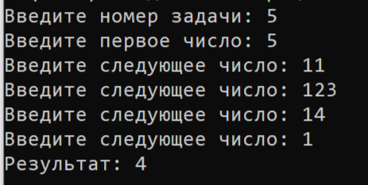

# Задание 2

## Задача 1

### Текст задачи

Безопасное деление.

Дана сигнатура функции: double safeDiv (int x, int y);
Необходимо реализовать функцию таким образом, чтобы она возвращала
деление x на y, и при этом гарантировала, что не будет выкинута ошибка
деления на 0. При делении на 0 следует вернуть из функции число 0. Подсказка:
смотри ограничения на операции типов данных.
Пример 1:
x=5 y=0
результат: 0
Пример 2:
x=8 y=2
результат: 4

### Алгоритм решения

1. Ввести два целых числа `x` и `y`.
2. Проверить корректность ввода. Если введены не числа, вывести сообщение об ошибке и повторить ввод.
3. Передать значения `x` и `y` в функцию `safeDiv()`.
4. Проверить, равно ли число `y` нулю.
5. Если `y` равно нулю, вернуть `0`, чтобы избежать деления на ноль.
6. Если `y` не равно нулю, разделить `x` на `y` и вернуть результат.
7. Вывести полученный результат на экран.

### Тестирование

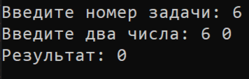
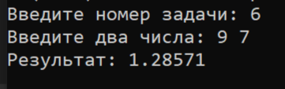

## Задача 2

### Текст задачи

Строка сравнения.

Дана сигнатура функции: String makeDecision (int x, int y);
Необходимо реализовать функцию таким образом, чтобы она возвращала
строку, которая включает два принятых функцией числа и корректно
выставленный знак операции сравнения (больше, меньше, или равно).
Пример 1:
x=5 y=7
результат: “5< 7”
Пример 2:
x=8 y=-1
результат: “8 >-1”
Пример 3:
x=4 y=4
результат: “4==4”

### Алгоритм решения

1. Ввести два целых числа `x` и `y`.
2. Проверить корректность ввода. Если введены не числа, вывести сообщение об ошибке и повторить ввод.
3. Передать значения `x` и `y` в функцию `makeDecision()`.
4. Сравнить значение `x` со значением `y`.
5. Если `x` меньше `y`, сформировать и вернуть строку вида `x < y`.
6. Если `x` больше `y`, сформировать и вернуть строку вида `x > y`.
7. Если `x` равно `y`, сформировать и вернуть строку вида `x == y`.
8. Вывести полученную строку на экран.

### Тестирование

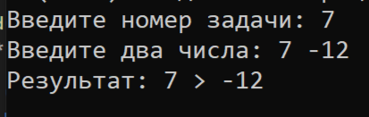
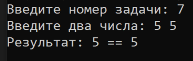

## Задача 3

### Текст задачи

Тройная сумма.

Дана сигнатура функции: bool sum3 (int x, int y, int z);
Необходимо реализовать функцию таким образом, чтобы она возвращала true,
если два любых числа (из трех принятых) можно сложить так, чтобы получить
третье.
Пример 1:
x=5 y=7 z=2
результат: true
Пример 2:
x=8 y=-1 z=4
результат: false

### Алгоритм решения

1. Ввести три целых числа `x`, `y` и `z`.
2. Проверить корректность ввода. Если введены не целые числа, вывести сообщение об ошибке и повторить ввод.
3. Передать значения `x`, `y` и `z` в функцию `sum3()`.
4. Проверить, равна ли сумма `x + y` числу `z`.
5. Проверить, равна ли сумма `x + z` числу `y`.
6. Проверить, равна ли сумма `y + z` числу `x`.
7. Если хотя бы одно из условий выполняется, вернуть `true`.
8. Если ни одно условие не выполняется, вернуть `false`.
9. Вывести полученный результат на экран.

### Тестирование

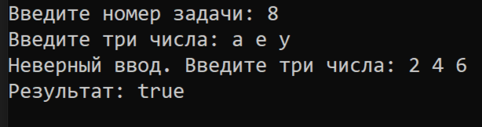

## Задача 4

### Текст задачи

Возраст.

Дана сигнатура функции: String age (int x);
Необходимо реализовать функцию таким образом, чтобы она возвращала
строку, в которой сначала будет число х, а затем одно из слов:
• год
• года
• лет
Слово “год” добавляется, если число х заканчивается на 1, кроме числа 11.
Слово “года” добавляется, если число х заканчивается на 2, 3 или 4, кроме чисел
12, 13, 14.
Слово “лет”добавляется во всех остальных случаях.
Подсказка: оператор % позволяет получить остаток от деления.
Пример 1:
x=5
результат: “5 лет”
Пример 2:
x=31
результат: “31 год”
Пример 3:
x=44
результат: “44 года”

### Алгоритм решения

1. Ввести целое число `x`, обозначающее возраст.
2. Проверить корректность ввода. Если введено не целое число или число меньше нуля, вывести сообщение об ошибке и повторить ввод.
3. Передать значение `x` в функцию `age()`.
4. Проверить последнюю цифру числа и две последние цифры числа.
5. Если число оканчивается на `1`, но не на `11`, добавить слово «год».
6. Если число оканчивается на `2`, `3` или `4`, но не на `12`, `13` или `14`, добавить слово «года».
7. Во всех остальных случаях добавить слово «лет».
8. Вернуть полученную строку.
9. Вывести результат на экран.

### Тестирование

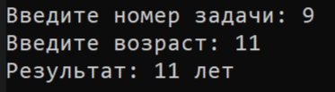

## Задача 5

### Текст задачи

Вывод дней недели.

Дана сигнатура функции: void printDays (int x);
В качестве параметра функция принимает число x, обозначаются день недели.
Необходимо реализовать функцию таким образом, чтобы она выводила на
экран название переданного в него дня и всех последующих до конца недели
дней. Если в качестве параметра передан не день (число, не в диапазоне от 1 от
7), то выводится текст “это не день недели”. Первый день понедельник,
последний – воскресенье. Вместо if в данной задаче используйте switch.
Пример 1:
x=4
результат:
четверг
пятница
суббота
воскресенье
Пример 2:
x=18
результат:
это не день недели

### Алгоритм решения

1. Ввести целое число `x`, обозначающее номер дня недели.
2. Проверить корректность ввода. Число должно находиться в диапазоне от 1 до 7. Если введено некорректное значение, вывести сообщение об ошибке и повторить ввод.
3. Передать значение `x` в функцию `printDays()`.
4. С помощью оператора `switch` определить день недели, соответствующий введённому числу.
5. Начиная с выбранного дня, последовательно вывести названия всех дней недели до воскресенья.
6. После вывода воскресенья завершить выполнение оператора `switch` с помощью `break`.

### Тестирование

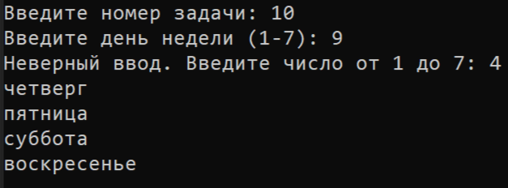

# Задание 3

## Задача 1

### Текст задачи

Числа наоборот.

Дана сигнатура функции: String reverseListNums (int x);
Необходимо реализовать функцию таким образом, чтобы она возвращала
строку, в которой будут записаны все числа от x до 0 (включительно).
Пример:
x=5
результат: “5 4 3 2 1 0”

### Алгоритм решения

1. Ввести целое неотрицательное число `x`.
2. Проверить корректность ввода. Если введено не целое число или число меньше нуля, вывести сообщение об ошибке и повторить ввод.
3. Передать значение `x` в функцию `reverseListNums()`.
4. Создать пустую строку для хранения результата.
5. С помощью цикла перебирать числа от `x` до `0`, уменьшая текущее число на единицу после каждой итерации.
6. Каждое число преобразовать в строку и добавить к результату.
7. Между числами добавить пробел.
8. После завершения цикла вернуть полученную строку.
9. Вывести результат на экран.

### Тестирование

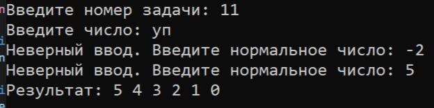

## Задача 2

### Текст задачи

Степень числа.

Дана сигнатура функции: int pow (int x, int y);
Необходимо реализовать функцию таким образом, чтобы она возвращала
результат возведения x в степень y.
Подсказка: для получения степени необходимо умножить единицу на число x,
и сделать это y раз, т.е. два в третьей степени это 1*2*2*2
Пример:
x=2
y=5
результат: 32

### Алгоритм решения

1. Ввести целое число `x`, являющееся основанием степени.
2. Проверить корректность ввода `x`. Если введено не целое число, вывести сообщение об ошибке и повторить ввод.
3. Ввести целое неотрицательное число `y`, являющееся показателем степени.
4. Проверить корректность ввода `y`. Если введено не целое число или число меньше нуля, вывести сообщение об ошибке и повторить ввод.
5. Передать значения `x` и `y` в функцию `pow()`.
6. Создать переменную `result` и присвоить ей значение `1`.
7. С помощью цикла выполнить умножение `result` на `x` ровно `y` раз.
8. После завершения цикла вернуть значение `result`.
9. Вывести полученный результат на экран.

### Тестирование

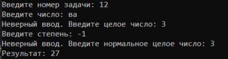

## Задача 3

### Текст задачи

Одинаковость.

Дана сигнатура функции: bool equalNum (int x);
Необходимо реализовать функцию таким образом, чтобы она возвращала true,
если все знаки числа одинаковы, и false в ином случае.
Подсказки:
intx=123%10; // х будет иметь значение 3
intу=123/10; // у будет иметь значение 12
Пример 1:
x=1111
результат: true
Пример 2:
x=1211
результат: false

### Алгоритм решения

1. Ввести целое неотрицательное число `x`.
2. Проверить корректность ввода. Если введено не целое число или число меньше нуля, вывести сообщение об ошибке и повторить ввод.
3. Передать значение `x` в функцию `equalNum()`.
4. Получить последнюю цифру числа и сохранить её для дальнейшего сравнения.
5. Удалить последнюю цифру из числа с помощью целочисленного деления на 10.
6. Пока в числе остаются цифры, получать очередную последнюю цифру и сравнивать её с сохранённой.
7. Если хотя бы одна цифра отличается, вернуть `false`.
8. После каждой проверки удалять рассмотренную цифру делением числа на 10.
9. Если все цифры одинаковые, вернуть `true`.
10. Вывести полученный результат на экран.

### Тестирование

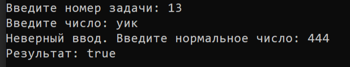

## Задача 4

### Текст задачи

Левый треугольник.

Дана сигнатура функции: void leftTriangle (int x);
Необходимо реализовать функцию таким образом, чтобы она выводила на
экран треугольник из символов ‘*’ у которого х символов в высоту, а количество
символов в ряду совпадает с номером строки.
Пример 1:
x=2
результат:
*
**
Пример 2:
x=4
результат:
*
**
***
****

### Алгоритм решения

1. Ввести целое число `x`, обозначающее высоту треугольника.
2. Проверить корректность ввода. Если введено не целое число или число меньше либо равно нулю, вывести сообщение об ошибке и повторить ввод.
3. Передать значение `x` в функцию `leftTriangle()`.
4. С помощью внешнего цикла последовательно сформировать `x` строк треугольника.
5. Для каждой строки с помощью внутреннего цикла вывести необходимое количество символов `*`.
6. В первой строке вывести одну звёздочку, во второй — две, и так далее.
7. После формирования каждой строки выполнить переход на новую строку.
8. После выполнения внешнего цикла завершить работу функции.

### Тестирование

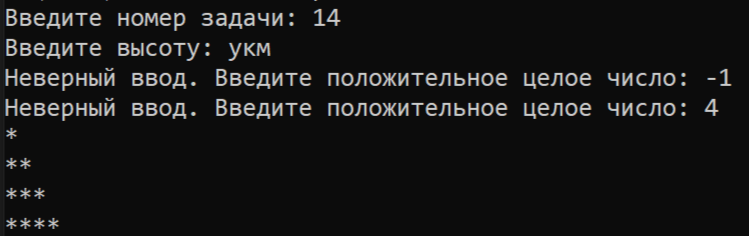

## Задача 5

### Текст задачи

Угадайка.

Дана сигнатура функции: void guessGame()
Необходимо реализовать функцию таким образом, чтобы она генерировала
случайное число от 0 до 9, далее считывала с консоли введенное пользователем
число и выводила, угадал ли пользователь то, что было загадано, или нет.
Функция запускается до тех пор, пока пользователь не угадает число. После
этого выведите на экран количество попыток, которое потребовалось
пользователю, чтобы угадать число.
Пример:
Введите число от 0 до 9:
5
Вы не угадали, введите число от 0 до 9:
9
Вы угадали!
Вы отгадали число за 2 попытки

### Алгоритм решения

1. Сгенерировать случайное целое число в диапазоне от 0 до 9.
2. Создать переменную для хранения введённого пользователем числа.
3. Создать счётчик попыток и присвоить ему значение 0.
4. Предложить пользователю ввести число от 0 до 9.
5. Проверить корректность ввода. Если введено не целое число или число находится вне диапазона от 0 до 9, вывести сообщение об ошибке и повторить ввод.
6. После корректного ввода увеличить количество попыток на 1.
7. Сравнить введённое число с загаданным.
8. Если числа не совпадают, сообщить об ошибочной попытке и предложить ввести число ещё раз.
9. Повторять ввод и проверку до тех пор, пока пользователь не угадает загаданное число.
10. После правильного ответа сообщить об успешном угадывании.
11. Вывести количество попыток, потребовавшихся пользователю.

### Тестирование

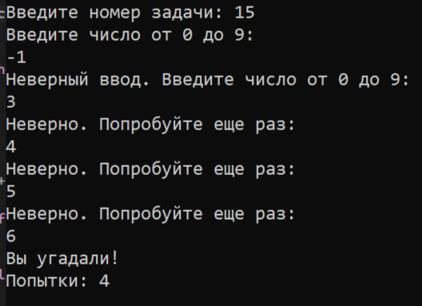

# Задание 4

## Задача 1

### Текст задачи

Поиск последнего значения.

Дана сигнатура функции: int findLast (int arr[], int x);
Необходимо реализовать функцию таким образом, чтобы она возвращала индекс
последнего вхождения числа x в массив arr. Если число не входит в массив –
возвращается -1.
Пример:
arr=[1,2,3,4,2,2,5]
x=2
результат: 5

### Алгоритм решения

1. Ввести размер массива `size`.
2. Проверить корректность размера массива. Если введено не целое число или число меньше либо равно нулю, вывести сообщение об ошибке и повторить ввод.
3. Создать массив размером `size`.
4. Ввести все элементы массива, проверяя корректность каждого введённого значения.
5. Ввести число `x`, последнее вхождение которого необходимо найти.
6. Передать массив, его размер и число `x` в функцию `findLast()`.
7. Начать просмотр массива с последнего элемента.
8. Последовательно сравнивать элементы массива с числом `x`, двигаясь от конца массива к его началу.
9. Если найден элемент, равный `x`, вернуть его индекс. Так как поиск выполняется с конца массива, найденный индекс будет индексом последнего вхождения.
10. Если после просмотра всего массива число `x` не найдено, вернуть `-1`.
11. Вывести полученный результат на экран.
12. Освободить память, выделенную для массива.

### Тестирование

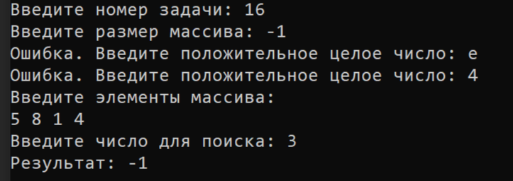

## Задача 2

### Текст задачи

Добавление в массив.

Дана сигнатура функции: int * add (int arr[], int x, int pos);
Необходимо реализовать функцию таким образом, чтобы она возвращала новый
массив, который будет содержать все элементы массива arr, однако в позицию pos
будет вставлено значение x.
Пример:
arr=[1,2,3,4,5]
x=9
pos=3
результат: [1,2,3,9,4,5]

### Алгоритм решения

1. Ввести размер исходного массива `size`.
2. Проверить корректность размера. Если введено не целое число или число меньше либо равно нулю, вывести сообщение об ошибке и повторить ввод.
3. Создать исходный массив размером `size`.
4. Ввести элементы массива, проверяя корректность каждого введённого значения.
5. Ввести число `x`, которое необходимо добавить в массив.
6. Ввести позицию `pos`, на которую необходимо добавить новый элемент.
7. Проверить позицию `pos`. Она должна находиться в диапазоне от `0` до `size`.
8. Передать исходный массив, его размер, значение `x` и позицию `pos` в функцию `add()`.
9. В функции создать новый массив размером `size + 1`.
10. Скопировать в новый массив все элементы исходного массива, расположенные до позиции `pos`.
11. Записать значение `x` в позицию `pos` нового массива.
12. Скопировать оставшиеся элементы исходного массива в новый массив со сдвигом на одну позицию вправо.
13. Вернуть указатель на новый массив.
14. Вывести элементы нового массива на экран.
15. Освободить динамическую память, выделенную для исходного и нового массивов.

### Тестирование

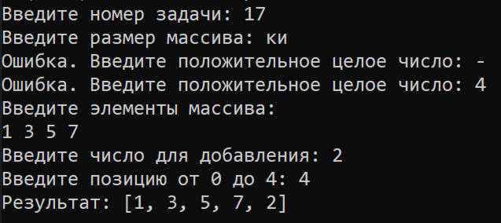

## Задача 3

### Текст задачи

Реверс.

Дана сигнатура функции: void reverse (int arr[]);
Необходимо реализовать функцию таким образом, чтобы он изменял массив arr.
После проведенных изменений массив должен быть записан задом-наперед.
Пример:
arr=[1,2,3,4,5]
результат: arr=[5,4,3,2,1]

### Алгоритм решения

1. Ввести размер массива `size`.
2. Проверить корректность размера массива. Если введено не целое число или число меньше либо равно нулю, вывести сообщение об ошибке и повторить ввод.
3. Создать массив размером `size`.
4. Ввести все элементы массива, проверяя корректность каждого введённого значения.
5. Передать массив и его размер в функцию `reverse()`.
6. Последовательно рассматривать элементы массива от начала до его середины.
7. Первый элемент поменять местами с последним, второй — с предпоследним и так далее.
8. Для перестановки элементов использовать временную переменную `temp`.
9. Продолжать перестановку до середины массива.
10. После завершения функции исходный массив будет записан в обратном порядке.
11. Вывести изменённый массив на экран.
12. Освободить память, выделенную для массива.

### Тестирование

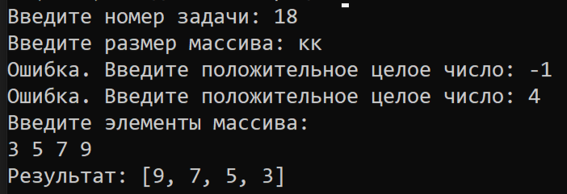

## Задача 4

### Текст задачи

Объединение.

Дана сигнатура функции: int * concat (int arr1[],int arr2[]);
Необходимо реализовать функцию таким образом, чтобы она возвращала новый
массив, в котором сначала идут элементы первого массива (arr1), а затем второго
(arr2).
Пример:
arr1=[1,2,3]
arr2=[7,8,9]
результат: [1,2,3,7,8,9]

### Алгоритм решения

1. Ввести размер первого массива `size1`.
2. Проверить корректность размера. Если введено не целое число или число меньше либо равно нулю, вывести сообщение об ошибке и повторить ввод.
3. Создать первый массив размером `size1` и ввести его элементы, проверяя корректность каждого значения.
4. Ввести размер второго массива `size2`.
5. Проверить корректность размера второго массива.
6. Создать второй массив размером `size2` и ввести его элементы, проверяя корректность каждого значения.
7. Передать оба массива и их размеры в функцию `concat()`.
8. В функции создать новый массив размером `size1 + size2`.
9. С помощью цикла скопировать все элементы первого массива в начало нового массива.
10. С помощью второго цикла скопировать все элементы второго массива в новый массив сразу после элементов первого массива.
11. Вернуть указатель на новый объединённый массив.
12. Вывести элементы полученного массива на экран.
13. Освободить память, выделенную для первого, второго и нового массивов.

### Тестирование

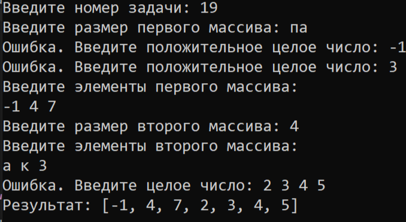

## Задача 5

### Текст задачи

Удалить негатив.

Дана сигнатура функции: int * deleteNegative (int arr[]);
Необходимо реализовать функцию таким образом, чтобы она возвращала новый
массив, в котором записаны все элементы массива arr кроме отрицательных.
Пример:
arr=[1,2,-3,4,-2,2,-5]
результат: [1,2,4,2]

### Алгоритм решения

1. Ввести размер массива `size`.
2. Проверить корректность размера. Если введено не целое число или число меньше либо равно нулю, вывести сообщение об ошибке и повторить ввод.
3. Создать исходный массив размером `size`.
4. Ввести все элементы массива, проверяя корректность каждого введённого значения.
5. Передать исходный массив, его размер и переменную `newSize` в функцию `deleteNegative()`.
6. Просмотреть все элементы исходного массива и подсчитать количество неотрицательных элементов.
7. Сохранить полученное количество в переменную `newSize`.
8. Создать новый массив размером `newSize`.
9. Ещё раз просмотреть исходный массив.
10. Если очередной элемент больше или равен нулю, записать его в новый массив.
11. Отрицательные элементы в новый массив не записывать.
12. Вернуть указатель на новый массив.
13. Вывести элементы нового массива на экран.
14. Освободить память, выделенную для исходного и нового массивов.

### Тестирование

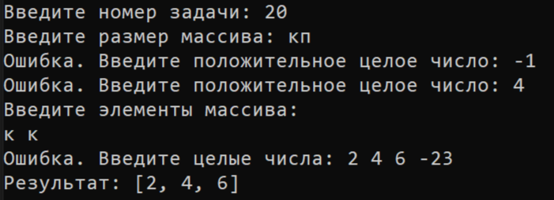
